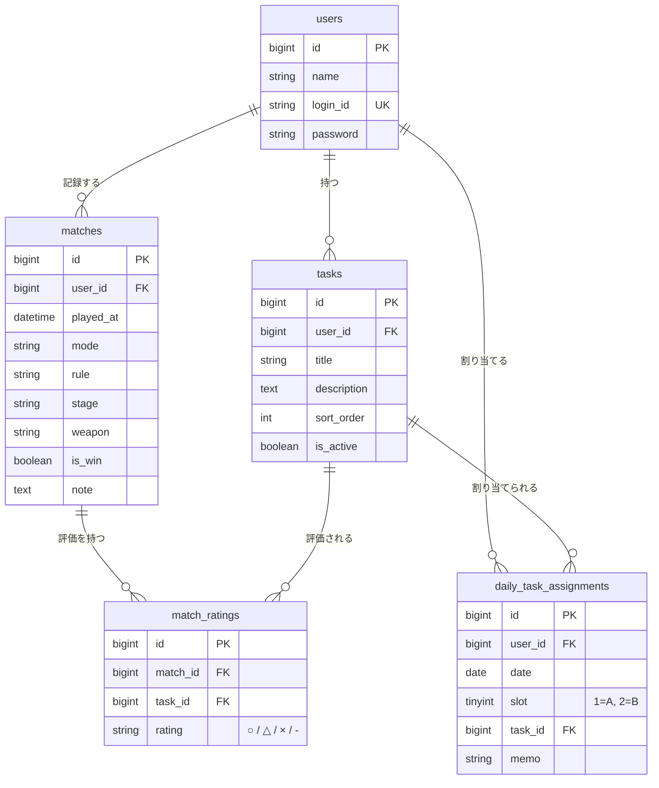

# 🎮 ikaeri — Game Training Task Tracker（MVP）
ゲーム練習の課題管理・振り返りアプリ（現在は Splatoon 向け。LoL 対応予定）

---

## 📌 概要

このアプリは、ゲーム練習の効率を上げるための「課題トラッキングツール」です。

- 意識したい課題を登録しておき、バトルごとに「今回の課題」を選ぶ
- バトルごとに課題を ○ / △ / × / -（未評価）で評価し、勝敗・コメントと一緒に記録する
- ダッシュボードとバトルログで振り返ることで成長が見える

複数ユーザー（4〜5人）でも利用可能な仕様になっています（課題・バトルはユーザーごとに分離されます）。

---

## 🔧 技術構成（Tech Stack）

### フロントエンド
- Next.js 16（App Router）
- React 19
- TypeScript
- Tailwind CSS 4
- Axios
- UI コンポーネントは自前（Card / PageHeader / ConfirmDialog / Toast など。clsx + tailwind-merge を使用）

### バックエンド
- Laravel 12
- PHP 8.4
- Laravel Sanctum（トークン認証）
- MySQL 8.0
- PHPUnit（テストは SQLite インメモリ）

### インフラ / 開発環境
- Docker / Docker Compose
  - 開発: `db` / `backend` / `frontend`
  - 本番: `db` / `backend` / `frontend` / `nginx`
- AWS EC2 で本番運用（Nginx のリバースプロキシ + Let's Encrypt の HTTPS。`/` → frontend、`/api/` → backend）
- GitHub Actions
  - CI: フロントエンドのビルド / バックエンドの phpunit / Docker イメージのビルド
  - 毎日の依存パッケージ脆弱性チェック（npm / composer）
- Dependabot（npm / composer / Docker ベースイメージ / GitHub Actions）

---

## 🧱 機能（MVP）

### 🔐 認証
- ユーザーID（`login_id`）+ パスワードで登録 / ログイン（パスワードは 8 文字以上、確認入力あり）
- ログアウト
- ログイン中ユーザーの取得（`/api/user`、`/api/me`）
- Sanctum のトークンを `localStorage` に保存し、`Authorization` ヘッダーで送信

### 📝 課題
- 課題（タイトル + 説明）の作成 / 一覧 / 編集 / 削除（`/tasks`）。他のユーザーの課題は操作できない
- ダッシュボードで課題の一覧確認・削除ができ、バトル追加画面ではその場で課題を追加できる
- 削除前は確認モーダル、失敗時はトーストで通知

### 🎮 バトル記録・振り返り（Match Reflection）
- バトル追加（`/matches/new`）は 2 ステップ
  1. 準備: 日時・ルール・ステージ・モード・ブキを入力し、今回意識する課題を選ぶ
  2. バトル中: 選んだ課題ごとに ○ / △ / × / - を評価し、勝敗・コメントを入力して保存
- 保存後は「次のバトルへ」（準備からやり直し）/「そのまま次のバトルへ」（ルール・ステージ・モード・ブキと課題の選択を引き継ぐ）を選べる
- バトルログ（`/matches`）: ステージ・ブキで絞り込み、5 件ずつのページネーション
- バトル詳細（`/matches/[id]`）: 試合情報・メモ・課題評価をそれぞれ個別に編集（日時は変更不可）

### 📅 サマリー（ダッシュボード）
- 直近 7 日（今日を含む）のモード別成績（バトル数 / 勝率 / 勝敗数）と、今日の成績を表示
- 最近のバトル 5 件を表示
- API（`GET /api/daily-summary`）は、直近 7 日の日別集計（バトル数・勝敗・勝率・○ △ × の件数）、7 日合計、モード別集計を返す
  - ○ △ × の件数は日ごとの合計で、課題ごとの集計ではない
  - ダッシュボードで表示しているのはモード別と今日の分のみ

---

## 🗂 データベース構成（簡易ER図）

- `matches` の Eloquent モデルは `GameMatch`
- `match_ratings` は `(match_id, task_id)` が一意（同じバトルの同じ課題は 1 回だけ）
- `daily_task_assignments`（日別の課題 A/B 割り当て）はテーブルのみ作成済みで、現在のアプリからは使われていない
